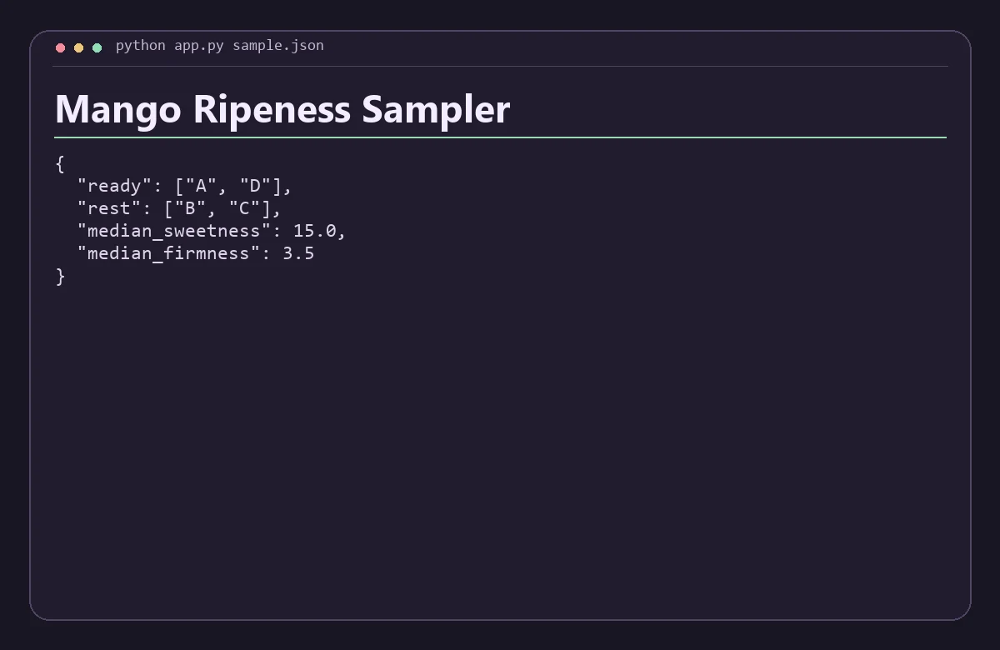

# Mango Ripeness Sampler

Group measured fruit samples by two editable ripeness thresholds and summarize how the batch is distributed.



## Run

Install Python 3.11 or newer. Run these commands from the repository root.

```sh
python app.py sample.json
```

Replace `sample.json` with a JSON file following the same structure. The app prints a JSON report to standard output.

Enter sample ID, sweetness reading, and firmness on a single consistent scale. A sample qualifies when it meets both inclusive user-defined thresholds. Ratings are supplied by the user.

## Verify

Run `python check.py` with Python 3.11 or newer after the build step when applicable. The check verifies the bundled scenario and confirms that an invalid input returns an error.
